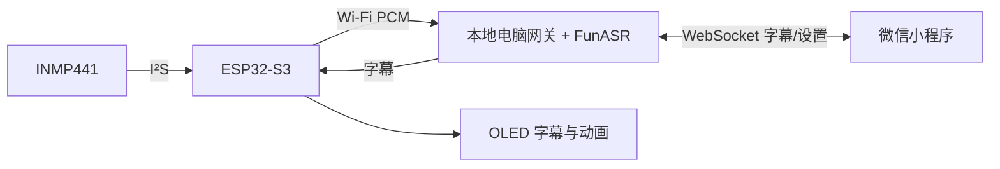

# ESP32-S3 Voice Companion

ESP32-S3 N16R8 + INMP441 + OLED + 微信小程序，本地运行阿里开源 FunASR。按住开发板 BOOT 录音，松开结束；电脑把同一份字幕直接推送给 OLED 和小程序。无需云端 ASR API。

## 已实现

- **按住说话**：启动时等按键释放、双边沿消抖；独立采音与按键任务，松开后仅发完已经采集的尾包，不追加录音。
- **流式字幕**：量化 Paraformer ONNX，16kHz/单声道/PCM16，20ms 二进制网络包，模型按 480ms 中央分块处理。
- **断句与标点**：FSMN-VAD 按停顿分句，CT-Transformer 补标点。停顿结束一个分句，松开才结束整次录音；连续讲话也有有界分段。
- **真实语音情绪**：SenseVoiceSmall 输出情绪和声音事件标签；独立进程、单线程、较低优先级，录音时暂停，字幕完成后补标签。没有标签显示 unknown，不根据关键词编造情绪或置信度。
- **OLED 动画**：待机、录音嘴形/音量、识别中、情绪表情；中文、字号、翻页、上滚、打字机、静态、亮度。
- **小程序直连电脑**：字幕增量更新、最终结果覆盖临时结果、重连补齐历史、实际设置确认。
- **速度保护**：模型常驻预热、I²S/网络/OLED分任务、有界队列、关闭PCM WebSocket压缩、慢客户端隔离。默认只允许一路录音，多个界面可同时订阅。

速度模式默认使用流式 ASR 缓存收尾 + 标点，**不在显示最终字幕之前再串行运行一次完整 ASR**。此前讨论的 2pass 是可选架构思路，本实现按“优先速度”选定上述路径，SenseVoice 只在空闲时补情绪，不修改字幕。480ms 是模型分块长度，不是端到端延迟承诺。实测数据与限制见 [验证记录](docs/validation.md)。



## 1. 接线

**断电后按引脚名称接线，不需要剪线。** 使用杜邦线，麦克风接线尽量短。OLED 已接的 GPIO8/9 保留。

| 模块 | 模块引脚 | ESP32-S3 GPIO / 电源 |
|---|---|---|
| OLED | VCC / GND | 3V3 / GND |
| OLED | SDA / SCL | GPIO8 / GPIO9 |
| INMP441 | VDD / GND | 3V3 / GND |
| INMP441 | SCK / WS / SD | GPIO4 / GPIO5 / GPIO6 |
| INMP441 | L/R | GND（左声道） |
| 板载按钮 | BOOT | GPIO0，按下为低电平 |

INMP441 的 SCK 是 I²S 位时钟，与 OLED 的 I²C SCL 不共线。麦克风不需要 MCLK。不同厂家板型先核对排针；N16R8 的部分存储器引脚不可作外设使用。按住 BOOT 再复位会进入下载模式，录音应在正常启动后操作。详见 [逐针接线与排错](docs/wiring.md)。

## 2. 本地电脑安装

推荐 **Windows x64 / Python 3.12 / CPU**，Linux 也可运行 Python 后端。首次需要联网安装依赖和下载模型；运行时只加载本地模型，不上传音频到云端。无需安装 PyTorch 或 CUDA。

```powershell
git clone https://github.com/ghtaoge/esp32-s3-voice-companion.git
cd esp32-s3-voice-companion
.\setup.ps1
```

已有 Python 但启动器定位错误时，使用 `setup.ps1 -Python "你的Python3.12完整路径"`。脚本把安装缓存和临时文件放在项目 `.downloads/`，不清理系统目录。需要镜像时可传 `-IndexUrl https://pypi.tuna.tsinghua.edu.cn/simple`。模型失败可重跑，已有文件校验后跳过。

检查资产与启动：

```powershell
.\.venv\Scripts\python.exe tools/download_models.py --check
.\start.ps1
```

等待模型预热。打开 `http://127.0.0.1:8765/api/health`，`ready:true` 表示字幕模型已就绪；`emotion` 独立显示 loading/ready/error/disabled。缺模型或加载失败会明确报错，不返回假字幕。

默认在 `0.0.0.0:8765` 监听供局域网设备接入。按 Windows 提示允许 Python 在专用网络通信；若手工配置防火墙，只开放本服务端口给局域网。电脑、手机、ESP32 必须能互相访问；访客 Wi-Fi/AP 隔离会阻止连接。

## 3. 配对电脑与设备

```powershell
.\pair.ps1 -Address 192.168.1.100
```

将示例地址换成电脑的局域网 IPv4，电脑可连接网线。生成 `.local/pairing.json` 和 `.local/pairing.png`，包含随机配对口令；打开二维码给小程序扫描。多网卡时应明确指定地址。

复制 `firmware/include/config.example.h` 为 **`firmware/include/config.local.h`**，填写 Wi-Fi、电脑地址及配对口令；设备 ID 默认 `esp32-s3`。这些本地文件、口令、模型和音频均被 Git 忽略。不要把配对二维码提交到公开仓库。

## 4. 烧录与小程序

使用 PlatformIO 打开 `firmware/`：

```powershell
cd firmware
pio run
pio device list
pio run --target upload --upload-port COM你的串口
pio device monitor --baud 115200 --port COM你的串口
```

烧录会替换开发板上的现有固件。当前交付不自动烧录。详细固件配置见 [firmware/README.md](firmware/README.md)。

微信开发者工具导入 `miniprogram/`。默认 `touristappid` 可看界面，真机预览使用自己的 AppID；按 [小程序说明](miniprogram/README.md) 生成本地副本以免把真实 AppID 提交。小程序扫码配对、连接电脑后，按住开发板 BOOT 讲话，松开等待最终字幕。

同网段 LAN 可以按微信局域网规则使用 `ws://电脑IP:端口`；正式跨网接入需按普通网络规则配置 WSS 域名和证书。这里提供局域网实现，不包含公网穿透。[微信局域网文档](https://developers.weixin.qq.com/miniprogram/dev/framework/ability/mDNS.html)

## 5. 速度、断句与情绪

- `start.ps1 -AsrThreads 3` 为默认。四核电脑给后台和系统留余量；用自己的音频比较 2/3/4 线程，不以线程越多越快作假设。
- 字幕模型在服务启动时加载并预热，录音时复用；每次录音和分句都清除独立的流式缓存，避免串音。
- 电脑处理不过来时返回明确过载错误，不通过静默丢音维持表面流畅。
- `start.ps1 -NoEmotion` 可关闭情绪进程做纯 ASR 对照。启用时，新录音会暂停本项目独立的情绪进程，处理完字幕后再恢复。
- 情绪只分析每句最多12秒，并有有界待处理队列；连续录音时可能延后或标记 skipped。它是模型对声音的分类，不等同于人的真实心理状态。
- 单次按住最长60秒。中途停顿只分句；超过12秒连续讲话强制形成有界分句，防止标点/分析任务无限增长。

可重复的真实 WAV 测试：

```powershell
.\.venv\Scripts\python.exe tools/benchmark_models.py models/_samples/asr_example.wav
# 另一个终端先启动服务，再实时回放音频到完整网关
.\.venv\Scripts\python.exe tools/replay_wav.py models/_samples/asr_example.wav --wait-emotion
```

前者报告模型推理时长，后者报告首字幕时间、松键到最终字幕的耗时和实际文本，二者口径不同。回放工具会以设备身份连接，请先断开真实开发板，避免替换它的连接。

## 开发与验证

```powershell
.\setup.ps1 -Dev -SkipModels
.\.venv\Scripts\python.exe -m pytest
cd miniprogram
npm test
```

固件编译与本机 C++ 测试见固件 README。测试替身只存在于 `tests/`；生产后端没有 mock 模型选项。

协议、ACK、分句修订与错误处理见 [docs/protocol.md](docs/protocol.md)。原始音频默认只在有界内存中处理，不持久保存；最终文本与情绪保存在 `.local/history.sqlite3`，每个设备最多保留50句。小程序当前会话最多缓存160个分句。

## 许可与依据

自有代码 MIT；第三方组件、字体和模型许可见 [THIRD_PARTY_NOTICES.md](THIRD_PARTY_NOTICES.md)。

- [FunASR ONNX 官方运行时](https://github.com/modelscope/FunASR/tree/main/runtime/python/onnxruntime)
- [SenseVoice 官方项目](https://github.com/FunAudioLLM/SenseVoice)
- [INMP441 数据手册](https://invensense.tdk.com/wp-content/uploads/2015/02/INMP441.pdf)
- [ESP32-S3-DevKitC-1 官方说明](https://docs.espressif.com/projects/esp-dev-kits/en/latest/esp32s3/esp32-s3-devkitc-1/user_guide_v1.1.html)
